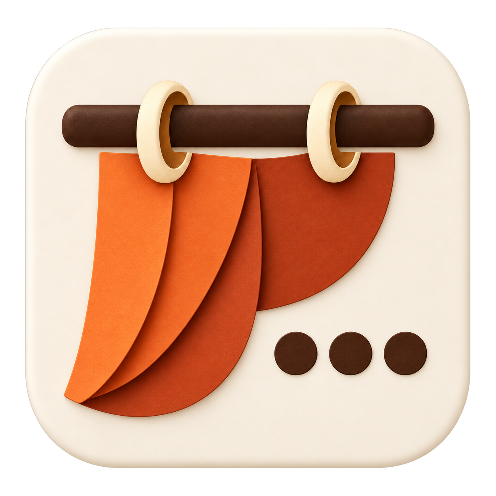

# Draplet



A free, open-source macOS utility that keeps both sides of your menu bar tidy.
Hide application menus on the left and selected status icons on the right,
then reveal them with a click, a hover, or a keyboard shortcut.

**Early alpha.** Draplet is changing quickly. The current version is 0.5.0.
Alpha downloads are not Developer ID signed or notarized.

## Features

- Hide File, Edit, View and other application menus behind a left-side curtain.
- Hide selected menu-bar icons on the right, with an optional always-hidden section.
- Keep the right arrow’s native accordion reveal. Only while the right strip is
  expanded, a separate [Pocket](docs/POCKET.md) down/up chevron sits leftmost,
  before every visible status icon, and opens real overflow or pinned items in a
  compact native popover. Collapsing immediately hides this control.
- With Curtain selected, Pocket and the right status icons reveal together under
  the existing mirrored curtain, using the selected pace.
- Keep chosen apps in Pocket even when the bar has room. ⌘-drag a status icon
  into Pocket to pin its app; ⌘-drag a pinned icon back to the menu bar to return it.
  Expand the original horizontal arrow to reach saved pins. Right settings also
  provides explicit placement controls. On macOS 27, all
  status icons from one pinned app move together.
- Reveal on hover or click, with shared or independent behavior for each side.
- Curtain and Fade animations, plus a native Hidden Bar mode for the right side.
- Matching or independent indicators, built-in presets and custom image import.
- Cached background matching, or optional Live matching for animated wallpapers.
- A configurable reveal shortcut, auto-hide delay and optional launch at login.
- Native Settings with light and dark appearances. A Dock icon appears while Settings is open.
- Signed in-app updates: automatic checks, background downloads and installation on quit.

## Requirements and current limits

- macOS 14.2 or later. The current development build is tested on macOS 27 with Apple silicon;
  other supported OS versions and Intel Macs still need hardware validation.
  Binary artifacts prepared on Apple silicon are arm64; Intel users must build locally.
- Accessibility access reads menu positions and fullscreen window state.
- Background matching and Pocket icon capture require Screen & System Audio
  Recording permission. Draplet captures no audio; images are processed locally.
  Pocket keeps a bounded local cache of last-good native glyphs on disk and never
  substitutes application artwork.
- Left-side hiding is a visual overlay. It does not free space for more status icons.
- macOS owns the menu bar during native fullscreen and Mission Control.
  Draplet withdraws its visual overlays and restores them after the desktop background settles.
- The macOS 27 native icon-hiding backend uses private, dynamically resolved APIs.
  An unavailable backend fails open, leaving icons visible. Future macOS updates may affect it.

## Build and run

Use a Mac with the Xcode command-line tools and a recent macOS SDK:

```sh
git clone https://github.com/nggurbanov/Draplet.git
cd Draplet
bash build.sh
ditto .build/Draplet.app /Applications/Draplet.app
open /Applications/Draplet.app
```

The build uses an available Apple Development signing identity, or ad-hoc signing
if none is available. You can select an identity with `DRAPLET_SIGNING_IDENTITY`.
Set `DRAPLET_SIGNING_IDENTITY=-` explicitly for an ad-hoc alpha build.
Public Developer ID signing and notarization are not configured yet.

Enable Draplet in System Settings → Privacy & Security → Accessibility and
Screen & System Audio Recording when prompted. Draplet detects permission changes.

To choose which icons hide, hold ⌘ and drag Draplet's right arrow to the right of
the icons you want hidden. macOS remembers the arrangement. With an always-hidden
section, place its dotted divider to the left of the arrow. ⌥-click reveals all sections.

The default shortcut is ⌃⌥Space. Settings provides alternatives.
Quit Hidden Bar before using Draplet's right-side hiding; both manage the same icons.
On macOS 26 and earlier, the legacy backend uses the visible vertical divider:
place it immediately left of the arrow, then ⌘-drag the icons you want hidden to
its left. Hardware validation of this legacy path is still pending.

## Updates

Draplet checks at launch and hourly by default. Downloaded updates install when you
quit Draplet; **Update and Relaunch** installs immediately. Ready updates stay visible
in Settings, with a reminder that can be deferred for an hour. Reminders wait while
you are in fullscreen or Mission Control. Automatic checks and background downloads
can be turned off in General. There is one update feed, with no channels.

Version 0.4.4 and earlier need one manual upgrade to get the updater.
See [update and release documentation](docs/UPDATES.md) for signing and local validation.

## Create a local DMG

```sh
bash scripts/build-dmg.sh
```

This builds a drag-to-Applications image in `dist/`, verifies its checksum, mounts it,
and checks the packaged app signature, executable and Applications shortcut.
The packaging environment is isolated under `.build/`.

Downloaded alpha builds may require an explicit Open Anyway approval in macOS.
Do not disable Gatekeeper or other system protections globally.

## Development and validation

```sh
bash test.sh
```

The 0.5.0 build-45 candidate passes 378 lifecycle, policy, rendering and
animation checks. The local native harness passes 17 scenarios, including rapid
reversals, actual arrow input, Pocket caching, fullscreen suppression and desktop
restoration. A separate two-publisher regression verifies 12 menu activations
without clicks reaching a foreign transparent blocker.

These are local alpha checks on macOS 27 / Apple silicon. Physical Command-drag,
arbitrary publisher popovers, older macOS, Intel and multiple displays still need
broader acceptance. Returning an unsupported extra may use a native compatibility
slot with its cached real glyph; changing counters/artwork need **Refresh Icons**.
See [release readiness](docs/RELEASE_READINESS.md) and the
[Pocket QA instructions](docs/POCKET.md#native-qa-harness) for scope and reproduction.
Captured window-state fixtures cover the Minecraft and Fladder regressions;
fixtures do not replace real hardware testing.

The UI is SwiftUI and AppKit. `Sources/LeftCurtain.swift` owns the left overlay;
`Sources/RightCurtain.swift` integrates icon hiding and right transitions;
`Sources/MenuBarBackdrop.swift` handles Cached/Live backgrounds.
`Sources/SystemPresentation.swift` and `Sources/ForegroundFullscreen.swift` coordinate
fullscreen and Mission Control suppression. Settings is in `Sources/Settings.swift`.

Cached mode stops capturing once a complete background is ready and refreshes on
relevant desktop changes. Live mode follows animated backgrounds. Fullscreen detection
uses window metadata and bounded Accessibility queries, without continuous screen capture.

Please report issues with the Draplet version, macOS version, display arrangement,
background mode and a short reproduction. Remove personal information from screenshots
and logs before sharing them. There is no automatic telemetry or crash-log upload.

## License and acknowledgments

Draplet is distributed under [GNU GPL version 3](LICENSE).
Pocket includes adapted code from [Ice](https://github.com/jordanbaird/Ice) by Jordan Baird and contributors.
Native MenuBarAgent geometry and identity matching also adapt work from
[Thaw](https://github.com/thaw-app/Thaw) by Toni Förster, under GPL v3.
Exact upstream provenance and modifications are recorded in
[Vendor/Ice/ORIGIN.md](Vendor/Ice/ORIGIN.md) and
[Vendor/Thaw/ORIGIN.md](Vendor/Thaw/ORIGIN.md).
The original MIT notice for pre-GPL Draplet code is retained in `LICENSES/Draplet-original-MIT.txt`.
When distributing binaries, provide the corresponding source for that exact build,
including build scripts, vendored adaptations, required dependency sources and
build instructions. See the [release checklist](docs/UPDATES.md).
Right-side hiding includes code from [Hidden Bar](https://github.com/dwarvesf/hidden)
by Dwarves Foundation, under MIT. The "Hidden Bar" indicator preset retains its
original artwork as an homage. See [ThirdPartyNotices.md](ThirdPartyNotices.md)
and [Vendor/HiddenBar/LICENSE](Vendor/HiddenBar/LICENSE).
In-app updates use [Sparkle](https://sparkle-project.org/); its complete license is
included in the app as `Sparkle-LICENSE`.

Resource behavior, optimization details and a repeatable CPU/memory measurement command are documented in [PERFORMANCE.md](docs/PERFORMANCE.md).

Pocket’s local hardware validation covers macOS 27 on Apple silicon; its
[compatibility limits](docs/POCKET.md#compatibility-limits) remain explicit.
